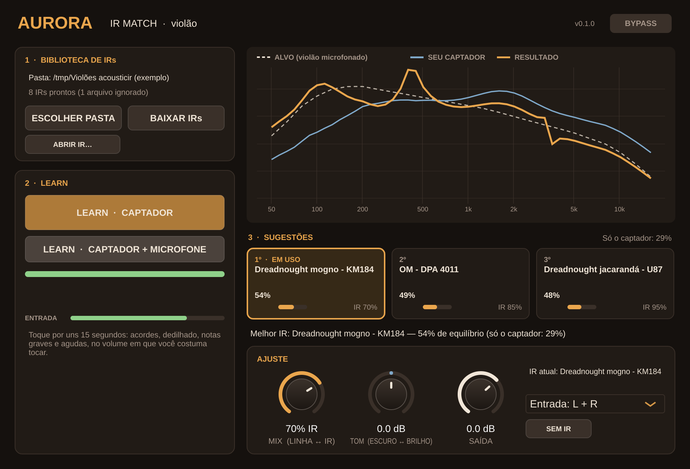

# Aurora IR Match

Plugin (AU / VST3) que deixa o som de **linha do violão** (captador piezo / magnético) com cara de
**violão microfonado**: nem "linha demais" (som de plástico, médios anasalados), nem "microfone demais".



## Como funciona

1. **Biblioteca de IRs** — você baixa os IRs que quiser (por exemplo do [acousticir.ovh](https://www.acousticir.ovh/),
   botão **BAIXAR IRs**) e coloca todos numa pasta. O plugin lê a pasta inteira (com subpastas), em
   `.wav` / `.aiff`, qualquer taxa de amostragem, mono ou estéreo. Os IRs não vêm junto com o plugin:
   eles são do autor do site.
2. **LEARN · CAPTADOR** — toque uns 15 segundos. O plugin mede o espectro médio do seu captador (só conta
   quando você está tocando) e testa **cada IR da biblioteca com cada mistura linha/IR (20 % a 100 %)**,
   prevendo o resultado (inclusive o filtro-pente entre a linha e o IR). Ele compara com a curva de um
   violão bem microfonado e carrega sozinho o melhor IR, com a melhor mistura. As 3 melhores sugestões
   ficam na tela, com a nota de equilíbrio de cada uma e a nota do captador sozinho.
3. **LEARN · CAPTADOR + MICROFONE** — se você tem o captador no canal 1 (L) e um microfone no canal 2 (R)
   de uma faixa estéreo, o plugin calcula o IR **do seu violão** (captador → microfone), salva em
   `Meus IRs Aurora` dentro da pasta da biblioteca e passa a usar só o canal 1.

Controles: **MIX** (linha ↔ IR), **TOM** (escuro ↔ brilho), **SAÍDA**, **ENTRADA** (L+R ou só canal 1)
e **BYPASS**. Latência zero.

## Compilar

```
cmake -B build -DCMAKE_BUILD_TYPE=Release
cmake --build build --config Release
./build/AuroraTests_artefacts/Release/AuroraTests
```

Cada push na `main` gera os instaladores no GitHub Actions (macOS .pkg universal, Windows, Linux),
testa o carregamento do plugin como uma DAW faria (Apple Silicon e Intel, AU e VST3) e publica o release.
